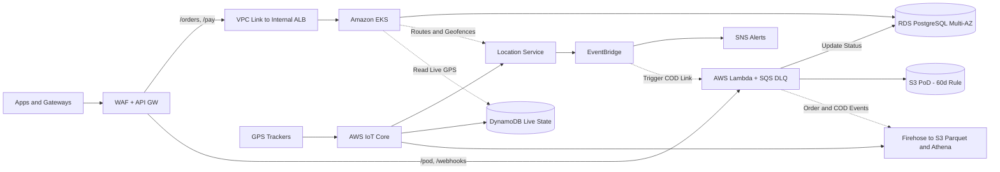

# Cloud-Native Event-Driven Logistics & Last-Mile Delivery Platform

A production-grade, multi-AZ AWS infrastructure and DevOps reference architecture for real-time fleet tracking, geofencing, last-mile Proof of Delivery (PoD), and Prepaid/COD payment processing.

## Architecture


## Key Engineering Highlights
- **Infrastructure as Code (IaC):** Modular Terraform provisioning a multi-AZ VPC, EKS, RDS Multi-AZ, API Gateway (VPC Link v2), IoT Core, and S3 Lifecycle rules.
- **High Availability & Scaling:** Containerized FastAPI microservices on Amazon EKS with HPA, PodDisruptionBudgets, and Internal ALB direct pod-IP routing.
- **DevSecOps:** Multi-stage non-root Docker images scanned with Trivy in GitHub Actions, EKS Pod Identity, AWS WAF, and Secrets Manager.
- **IoT & Analytics:** AWS IoT Core → Amazon Location Service → EventBridge → SNS, DynamoDB live state, Data Firehose → S3 (Parquet) → Athena, and 60-day S3 PoD retention.

## Deployment
```bash
cd terraform/environments/dev
terraform init && terraform apply
aws eks update-kubeconfig --region me-central-1 --name dcs-lastmile-dev
kubectl apply -k k8s/overlays/dev